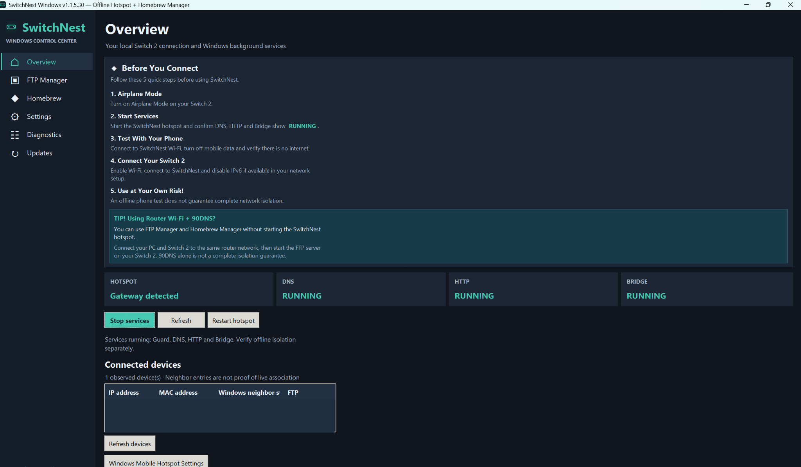
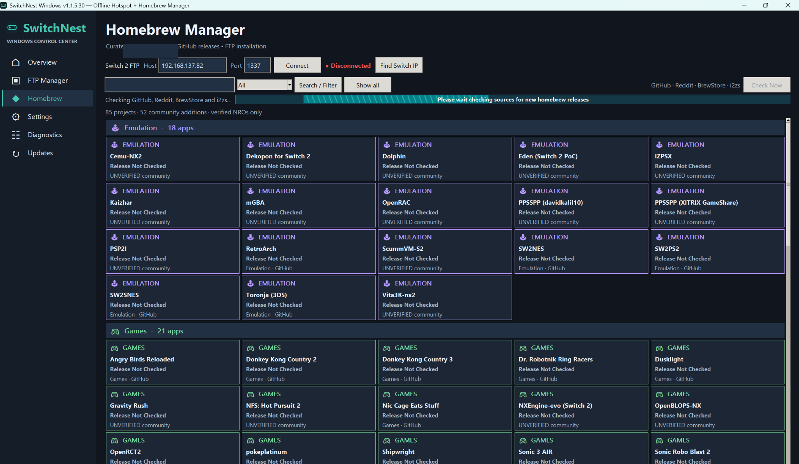

# SwitchNest AIO

### One workspace. Essential Switch 2 tools.

A streamlined Windows companion application for managing homebrew, transferring files, and configuring supported local connectivity workflows.

**Windows 10 / 11 · x64 · Beta**

[Releases](https://github.com/blueshockz47/SwitchNest-AIO/releases) · [Report an issue](https://github.com/blueshockz47/SwitchNest-AIO/issues)

---

## Overview

SwitchNest AIO brings frequently used Nintendo Switch 2 companion utilities into a single desktop interface. Built on the existing SwitchNest Windows project, it prioritizes a clear workflow, practical tools, and predictable behavior.

## Features

- **Homebrew Manager** — Browse supported homebrew sources and manage compatible packages.
- **FTP File Manager** — Transfer and organize files through an available FTP connection, with convenient file-management controls.
- **Hotspot & Network Tools** — Configure and inspect supported Windows connectivity workflows.
- **Unified Desktop Experience** — Keep essential utilities together in one Windows application.

Feature availability depends on the connected device, compatible software, Windows permissions, and the installed build. Additional integrations will be documented when implemented and tested.

## Application Preview

A look at the current SwitchNest Windows interface. Screenshots are from the existing application; branding and version labels will be updated for the AIO beta.

### Overview

### FTP Manager

### Homebrew Manager

### Settings

## Download

**First planned release: `v1.0.0-Beta`**

The beta download will appear on the [Releases page](https://github.com/blueshockz47/SwitchNest-AIO/releases) after the Windows package passes validation and is published. No download is available from this repository yet.

## Requirements

- Windows 10 or Windows 11 (64-bit)
- Compatible network adapter and permissions for features that modify network settings
- A supported device and connection for file transfer

Some features require administrator approval. Hardware compatibility and connectivity may vary.

## Beta notice

SwitchNest AIO is in active development. Back up important data before testing and review any network changes before applying them. Beta releases may contain incomplete functionality or known issues.

## Credits

**Project:** [blueshockz47](https://github.com/blueshockz47)

SwitchNest AIO builds on the work behind [SwitchNest Windows](https://github.com/blueshockz47/SwitchNest-Windows). Thanks to the developers and maintainers of the independent homebrew, networking, and open-source tools that make this ecosystem possible. Project-specific upstream acknowledgements and license notices will be maintained as integrations are verified.

*SwitchNest AIO is an independent community project and is not affiliated with or endorsed by Nintendo.*
