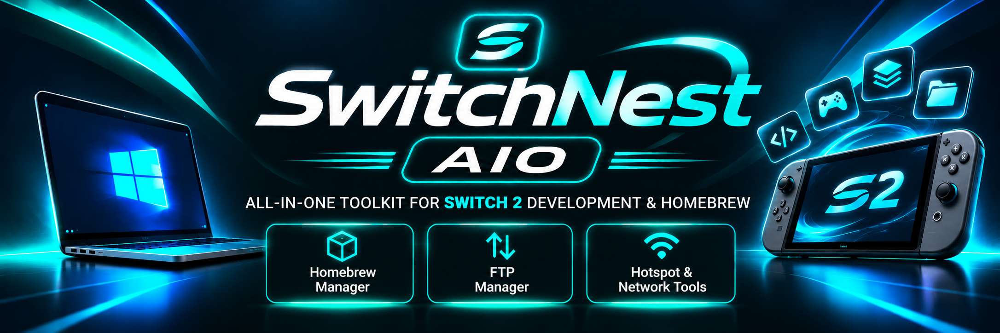
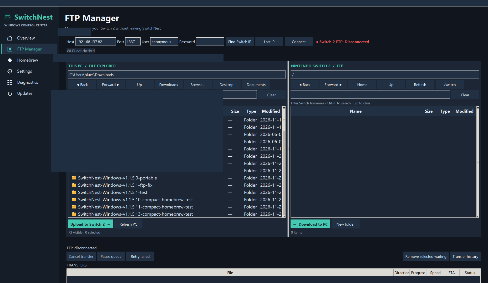
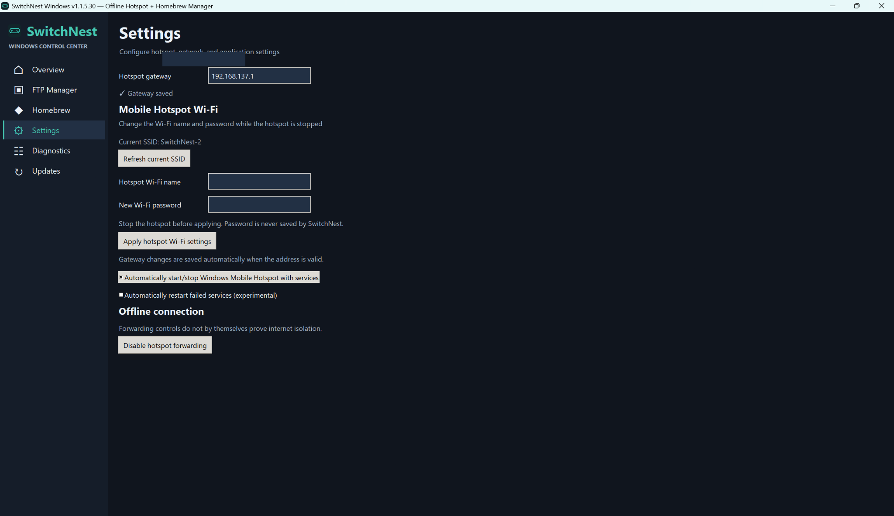

# SwitchNest AIO

### One workspace. Essential Switch 2 tools.

A streamlined Windows companion application for managing homebrew, transferring files, and configuring supported local connectivity workflows.

**Windows 10 / 11 · x64 · Beta**

[Releases](https://github.com/blueshockz47/SwitchNest-AIO/releases) · [Report an issue](https://github.com/blueshockz47/SwitchNest-AIO/issues)

---

## Overview

SwitchNest AIO brings frequently used Nintendo Switch 2 companion utilities into a single desktop interface. Built on the foundation of the SwitchNest Linux project, it prioritizes a clear workflow, practical tools, and predictable behavior.

## Features

### Homebrew Manager
- Browse a curated homebrew catalog organized by category.
- Check supported GitHub repositories for new releases and available NRO files.
- Download eligible NRO releases and install them over FTP to the connected console, with confirmation and applicable integrity checks.
- Discover community projects from supported sources; community listings are not automatically treated as verified or safe to install.

### FTP File Manager
- Browse PC files and the connected console's FTP directories side by side.
- Upload and download files, create folders, and navigate directories from one window.
- Manage transfers with a queue, progress information, pause and retry controls.
- Find a console's FTP address and optionally reconnect after a dropped connection.

### Hotspot & Network Tools
- Create and manage a local Windows hotspot for supported Switch 2 connectivity workflows. A working Ethernet (LAN) or Wi-Fi connection with internet access is required on the Windows PC as the source connection for Windows Mobile Hotspot.
- Use local DNS resolution and HTTP responses to handle supported connectivity-test requests without requiring an upstream internet connection.
- Keep local FTP and homebrew file-transfer services accessible over the hotspot.
- Monitor DNS, HTTP, bridge, gateway, and connection status from the dashboard.
- Configure hotspot Wi-Fi settings and troubleshoot network issues.
- **Important:** Local DNS responses do not guarantee that all console connectivity checks will pass or that the hotspot is fully offline. Verify internet isolation independently before connecting a console.

### Unified Windows Interface
- Access the dashboard, FTP, Homebrew, network settings, diagnostics, and update controls in one place.
- Check service status and troubleshoot connections without switching between separate utilities.

Features depend on device compatibility, network configuration, Windows permissions, and the installed build. A repository listing or successful download does not establish that homebrew is safe or compatible.

## Application Preview

A look at the current SwitchNest Windows interface. Screenshots are from the existing application; branding and version labels will be updated for the AIO beta.

### Overview

### FTP Manager

### Homebrew Manager

### Settings

## Download

**First planned release: `v1.0.0-Beta`**

The beta download will appear on the [Releases page](https://github.com/blueshockz47/SwitchNest-AIO/releases) after the Windows package passes validation and is published. No download is available from this repository yet.

## Requirements

- Windows 10 or Windows 11 (64-bit)
- A working Ethernet (LAN) or Wi-Fi connection with internet access on the Windows PC to serve as the source for Windows Mobile Hotspot
- Compatible network adapter and permissions for features that modify network settings
- A supported device and connection for file transfer

Some features require administrator approval. Hardware compatibility and connectivity may vary.

## Beta notice

SwitchNest AIO is in active development. Back up important data before testing and review any network changes before applying them. Beta releases may contain incomplete functionality or known issues.

## Credits

**Project development:** [blueshockz47](https://github.com/blueshockz47)

**Project foundation:** [SwitchNest Linux / SwitchNest Hotspot](https://github.com/blueshockz47/SwitchNest-Hotspot) — the original Linux project and its homebrew catalog approach. The Windows implementation also builds on [SwitchNest Windows](https://github.com/blueshockz47/SwitchNest-Windows).

### Libraries and platform components

- [Python](https://www.python.org/) and [Tkinter/Tcl-Tk](https://docs.python.org/3/library/tkinter.html) — application runtime and desktop interface.
- [PyInstaller](https://pyinstaller.org/) — Windows executable packaging.
- [tkinterdnd2](https://github.com/pmgagne/tkinterdnd2) — drag-and-drop integration.
- [dnslib](https://github.com/paulc/dnslib) — DNS packet handling.
- [pydivert](https://github.com/ffalcinelli/pydivert) and [WinDivert](https://github.com/basil00/WinDivert) — Windows packet interception and filtering.
- [Windows Runtime (WinRT)](https://learn.microsoft.com/en-us/uwp/api/windows.networking.networkoperators.networkoperatortetheringmanager) and the [Python WinRT bindings](https://pypi.org/project/winrt-Windows.Networking.NetworkOperators/) — Windows Mobile Hotspot control.
- Microsoft Windows Mobile Hotspot, Internet Connection Sharing (ICS), and Windows Firewall — operating-system networking facilities.

### Homebrew discovery and community sources

- [GitHub](https://github.com/) — repository metadata and release distribution.
- [BrewStore community catalog](https://github.com/HerXayah/brewstore-repo) by HerXayah — external homebrew catalog listings.
- [Switch 2 Homebrew Catalog (i2zs)](https://github.com/dadadush/switch2-homebrew-catalog) by dadadush — external homebrew catalog listings.
- [r/switch2hacks](https://www.reddit.com/r/switch2hacks/) — community project discovery.

**Homebrew authors and maintainers:** The Homebrew Manager references independent projects, including [RetroArch-S2](https://github.com/NerdsMcGee/retroarch-s2), [SW2PS2](https://github.com/Rodpad/SW2PS2), [kaiHEN FTPD Plugin](https://github.com/NerdsMcGee/kaihen-ftpd-plugin), [Checkpoint](https://github.com/wowilookgood/Checkpoint), and many others. Credit and licensing for each homebrew belong to its respective authors and repositories. Listing a project does not imply endorsement, verification, or inclusion of its code in SwitchNest AIO.

**Licenses:** This acknowledgment is not a substitute for required third-party copyright notices or license texts. These must be reviewed and included with any redistributed dependencies or binaries before the beta release.

*SwitchNest AIO is an independent community project and is not affiliated with or endorsed by Nintendo.*
